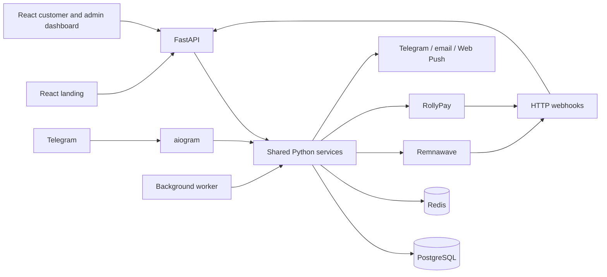

# VLESS VPN Shop

[Русский](README.md) · [English](README.en.md)

A self-hosted VLESS VPN shop with a Telegram bot, landing page and customer dashboard for selling subscriptions through Remnawave. The website and bot share accounts, catalog, orders and payments in one database.

[Installation](docs/INSTALL_EN.md) · [Features (RU)](docs/FEATURES.md) · [Architecture (RU)](docs/ARCHITECTURE.md) · [Security](SECURITY.md)

## Connect payment providers

| Provider | Merchant onboarding |
| --- | --- |
|  RollyPay | [Contact Victoria rollypay](https://t.me/Victoria_rollypay?text=Здравствуйте%2C%20хочу%20подключить%20вашу%20платежку%2C%20рекомендация%20%40o3amfeels) |
|  Platega.io | [Contact Alexander Platega](https://t.me/AlexanderPlatega?text=Здравствуйте%2C%20хочу%20подключить%20вашу%20платежку%2C%20рекомендация%20%40o3amfeels) |

Free integration of the Platega API may be available when you connect Platega. For integration inquiries, contact [@o3amfeels](https://t.me/o3amfeels).

The links open merchant onboarding contacts with a referral from @o3amfeels. The payment provider decides whether to approve the application; approval is not guaranteed. The referral does not imply official endorsement of this project by the providers. Report vulnerabilities through the [security channel](SECURITY.md).

## Features

- Email code login, Telegram login and Telegram Mini App authentication; verified account linking.
- Subscription purchases, renewals, plan changes and device limits with server-side pricing.
- Remnawave provisioning, connection instructions, device inventory and access revocation.
- Promo codes, referral rewards, purchase history and notifications.
- Administration of catalog, content, customers, broadcasts and financial reports.

Payments use RollyPay; instance settings determine available payment methods. The code blocks new recurring enrollment in live mode. Existing agreements have separate handling and cancellation checks. See the [feature reference (RU)](docs/FEATURES.md) for limitations.

## Interface

Actual application screens with synthetic data. Names and prices are examples.

Customer dashboard and service management

## Getting started

Follow the [installation guide](docs/INSTALL_EN.md). Development supports synthetic fixtures, provider test doubles and recipient allowlists. A real installation needs its own Telegram, email, Remnawave and payment configuration. The product interface is Russian; this English README does not imply an English UI.

New production instances have staged database preparation, explicit first activation and an HTTPS Compose bundle renderer with static frontend files. This requires operator-owned external PostgreSQL/Redis and TLS. Isolated installation has been checked with real PostgreSQL/Redis and mocked external providers; see [deployment instructions and verification limits (RU)](docs/DEPLOYMENT.md).

> [!NOTE]
> This edition is being prepared for its first public release. Clean Docker builds, migrations, local ingress access, network restrictions and isolated scenarios with mocked providers have passed. These checks do not establish working live payments or external integrations.

## Architecture

`packages/core` contains domain calculations. `packages/infrastructure` contains shared services and integrations. The API, bot and worker use the same implementation. See [architecture (RU)](docs/ARCHITECTURE.md).

## Branding

Set names, URLs, contacts and optional images through the typed [instance configuration](config/instance.example.json). The neutral profile works without a logo. `APP_NAME` overrides the display name; `INSTANCE_CONFIG_PATH` selects the instance file. Catalog and prices belong to the shared database and admin interface.

Author: **shipap**. Own code: [AGPL-3.0-only](LICENSE). Third-party terms remain in the [notices](docs/THIRD_PARTY_NOTICES.md).

[Configuration (RU)](docs/CONFIGURATION.md) · [Deployment (RU)](docs/DEPLOYMENT.md) · [Updates (RU)](docs/UPDATING.md) · [Backups (RU)](docs/BACKUP_RESTORE.md) · [Troubleshooting (RU)](docs/TROUBLESHOOTING.md)

[Contributing](CONTRIBUTING.md) · [Publication preparation (RU)](docs/GITHUB_PUBLICATION.md)

## Contact the author

VLESS VPN Shop author: shipap. For development, customization, integrations, commercial projects and collaboration:

[work@bububi.icu](mailto:work@bububi.icu) · [Telegram: @o3amfeels](https://t.me/o3amfeels) · [GitHub: shipap](https://github.com/shipap)
