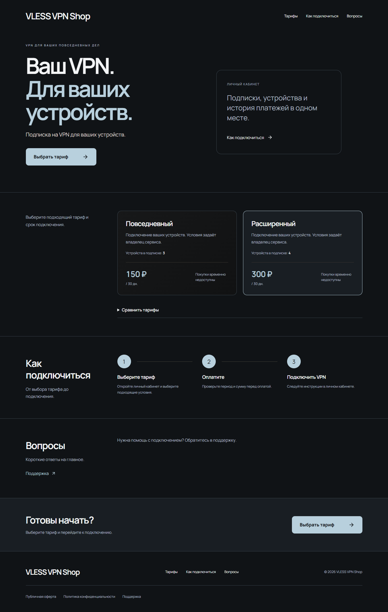
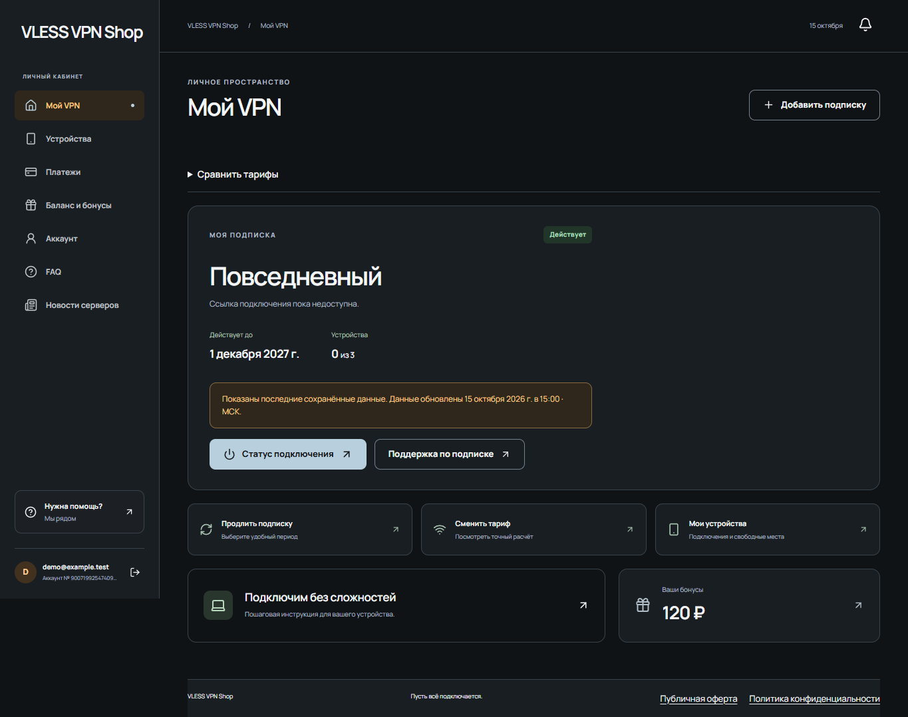
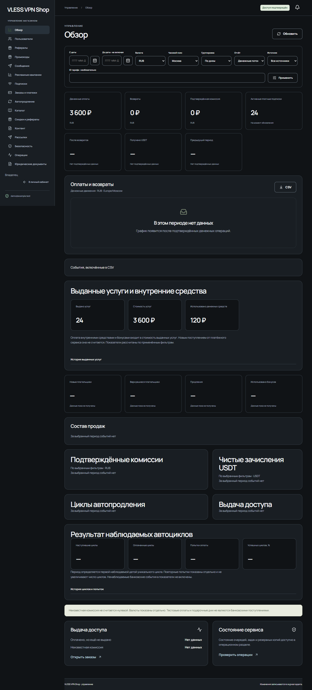
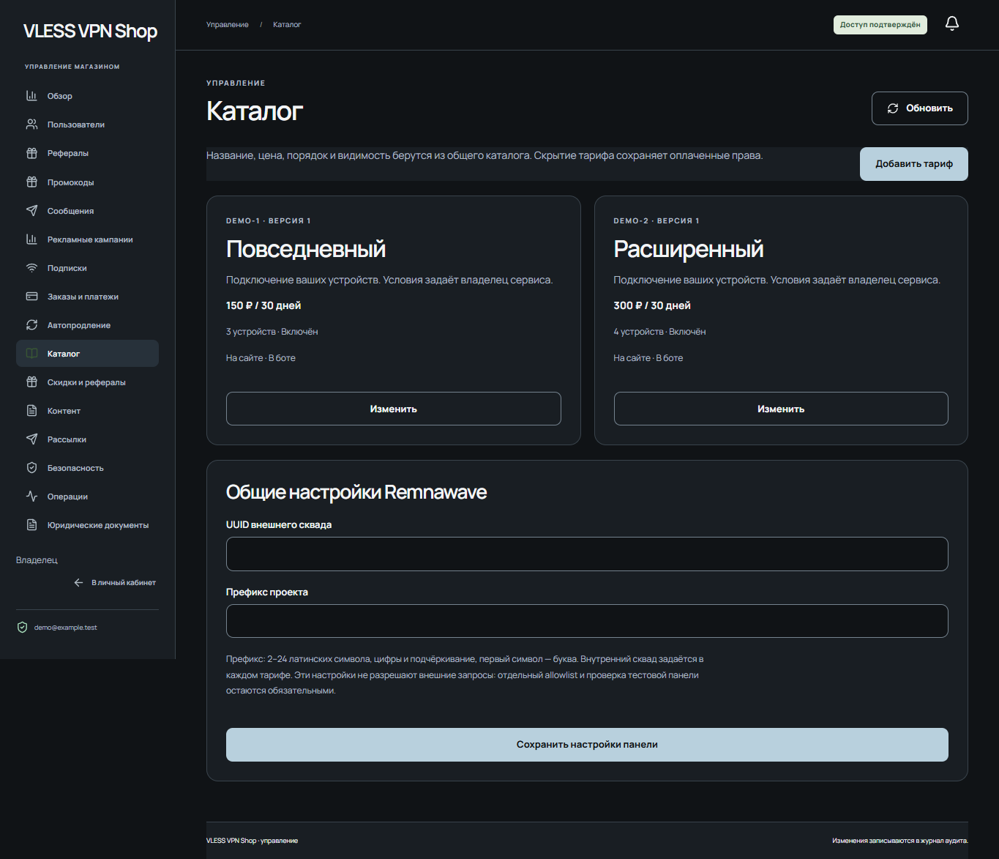
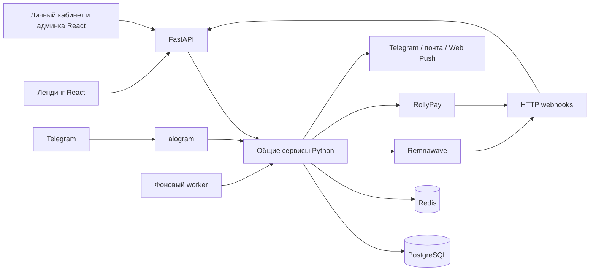

# VLESS VPN Shop

[Русский](README.md) · [English](README.en.md)

Самостоятельный VPN-магазин для VLESS: Telegram-бот, лендинг и личный кабинет для продажи подписок через Remnawave. Сайт и бот используют общую базу аккаунтов, тарифов, заказов и платежей.

[Установка](docs/INSTALL_RU.md) · [Возможности](docs/FEATURES.md) · [Архитектура](docs/ARCHITECTURE.md) · [Безопасность](SECURITY.md)

## Что умеет

- Вход по коду из почты, через Telegram и Telegram Mini App; подтверждённая привязка аккаунтов.
- Покупка и продление подписок, переход между тарифами, изменение числа устройств с расчётом на сервере.
- Подключение к Remnawave, инструкции для клиента, список устройств и отзыв доступа.
- Промокоды, реферальные начисления, история покупок и уведомления.
- Админка для каталога, контента, пользователей, рассылок и финансовой аналитики.

Платёжная интеграция использует RollyPay. Доступные методы определяет настройка экземпляра. Новое подключение автопродления в live-режиме заблокировано кодом; обработка существующих соглашений имеет отдельные проверки. Подробности и ограничения: [возможности](docs/FEATURES.md).

## Интерфейс

Снимки настоящего интерфейса с синтетическими данными; цены и названия служат примером.

Личный кабинет и управление сервисом

## Установка

Следуйте [инструкции установки](docs/INSTALL_RU.md). Для разработки предусмотрены синтетические данные, подмены провайдеров и ограничения получателей. Реальная установка требует собственных Telegram-, почтовых, Remnawave- и платёжных настроек.

Для новой production-установки есть поэтапная подготовка базы, отдельная первая активация и генератор HTTPS Compose-bundle со статическим frontend. Нужны собственные внешние PostgreSQL/Redis и TLS. Изолированная установка проверена с настоящими PostgreSQL/Redis и подменами внешних провайдеров; команды и границы проверок приведены в [руководстве развёртывания](docs/DEPLOYMENT.md).

> [!NOTE]
> Эта редакция готовится к первому публичному выпуску. Проверены чистые сборки Docker, миграции, доступ через локальный ingress, сетевые ограничения и изолированные сценарии с подменами провайдеров. Работа реальных платежей и внешних интеграций этими проверками не подтверждается.

## Как устроено

Правила расчёта находятся в `packages/core`, сервисы и интеграции в `packages/infrastructure`. API, бот и worker подключают их из одного дерева исходников. Подробнее: [архитектура](docs/ARCHITECTURE.md).

## Свой экземпляр

Название, адреса, контакты и изображения задаются через типизированную конфигурацию: [instance.example.json](config/instance.example.json). Нейтральный профиль работает без логотипа. `APP_NAME` переопределяет название; `INSTANCE_CONFIG_PATH` выбирает файл экземпляра. Каталог и цены редактируются через общую базу и админку.

Автор: **shipap**. Собственный код: [AGPL-3.0-only](LICENSE). Условия сторонних компонентов сохраняются отдельно в [уведомлениях](docs/THIRD_PARTY_NOTICES.md).

[Конфигурация](docs/CONFIGURATION.md) · [Развёртывание](docs/DEPLOYMENT.md) · [Обновление](docs/UPDATING.md) · [Резервные копии](docs/BACKUP_RESTORE.md) · [Решение проблем](docs/TROUBLESHOOTING.md)

[Участие в разработке](CONTRIBUTING.md) · [Подготовка публикации](docs/GITHUB_PUBLICATION.md)

## Связь с автором

Автор VLESS VPN Shop: shipap. По вопросам разработки, доработок, интеграций, коммерческих проектов и сотрудничества:

[work@bububi.icu](mailto:work@bububi.icu) · [Telegram: @o3amfeels](https://t.me/o3amfeels) · [GitHub: shipap](https://github.com/shipap)

##  Подключение RollyPay

Кнопка открывает внешний контакт для подключения магазина к RollyPay с рекомендацией @o3amfeels. Решение о подключении принимает платёжный провайдер; одобрение не гарантируется. Рекомендация не означает официального одобрения проекта со стороны RollyPay. Об уязвимостях сообщайте через [канал безопасности](SECURITY.md).
