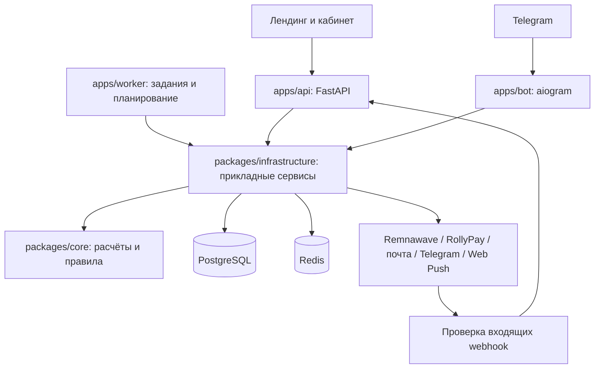
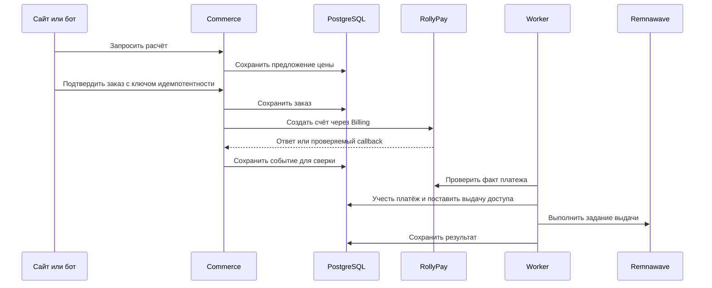

# Архитектура

[README](../README.md) · [Возможности](FEATURES.md)

Приложение является модульным монолитом на Python. API, Telegram-бот и worker запускаются отдельными процессами и используют общие сервисы с одной PostgreSQL. Лендинг и кабинет являются отдельными React-приложениями. Кабинет включает защищённые административные страницы.

## Границы модулей

| Путь | Ответственность |
| --- | --- |
| `apps/api/src/sunrise_api` | HTTP, аутентификация, проверки доступа, сборка зависимостей |
| `apps/bot/src/sunrise_bot` | Telegram-обработчики и представление общих операций |
| `apps/worker/src/sunrise_worker` | Исполнение заданий, сверка и планирование |
| `apps/web/landing` | Публичная витрина |
| `apps/web/dashboard` | Кабинет пользователя и административный интерфейс |
| `packages/core/src/sunrise_core` | Денежные расчёты, устройства, ошибки, семантический контент |
| `packages/infrastructure/src/sunrise_infrastructure` | Общие прикладные сервисы, ORM, провайдеры, конфигурация |
| `packages/web-ui` | Общие компоненты и представление данных |
| `packages/api-client` | Клиент HTTP и типы контракта |
| `migrations` | Единая история Alembic |
| `contracts` | Контракты HTTP |

Основная оркестрация покупок находится в `commerce.py`; чистые формулы вынесены в `sunrise_core.pricing`. Прикладные сервисы сейчас размещены вместе с адаптерами в `packages/infrastructure`. Изменение этой структуры требует проверки импортов и общего поведения сайта и бота.

## Данные и транзакции

PostgreSQL хранит аккаунты, каталог, подписки, предложения цены, заказы, платежи, соглашения, уведомления и задания. Redis хранит временное состояние, ограничения запросов и блокировки координации. Финансовые факты сохраняются в PostgreSQL.

Внутренний ID аккаунта независим от nullable Telegram ID. BIGINT-идентификаторы передаются клиентам строками. Денежные расчёты используют Decimal, денежные столбцы используют NUMERIC. Миграции выполняются отдельно от запуска приложения.

Сайт и бот вызывают общую реализацию покупки. Между ними нет webhook синхронизации. Остановка Telegram polling не должна требоваться для работы HTTP-кабинета.

## Заказ и внешний провайдер

Короткие транзакции, блокировки строк и уникальные ключи защищают повторное исполнение. Сохранённые операции провайдера позволяют различать подтверждённый результат и неизвестный исход. Восстановление неизвестного счёта выполняет GET и не повторяет создание счёта. Принятый результат проходит общий путь проверки платежа.

## События и фоновые задачи

Worker использует лидерскую блокировку Redis для планирования; операции дополнительно защищены состоянием и блокировками базы. Он обрабатывает выдачу доступа, уведомления, рассылки и разрешённую сверку внешних состояний.

Remnawave webhook проверяется до обработки. Обновление подписки также возможно по запросу пользователя и перед расчётом покупки. Названия и доступность серверов проходят через сопоставления продуктов и панели. Лента серверных новостей отделена от пользовательских уведомлений.

## Конфигурация и доступ

`InstanceConfig` задаёт название, оформление, публичные адреса и контакты. Каталог и административный контент хранятся в базе. Серверные секреты не должны попадать в публичную конфигурацию и frontend bundle.

Сессии, CSRF, одноразовые подтверждения и MFA защищают HTTP-операции. Административная принадлежность опирается на проверенную Telegram-идентичность и настроенные права. Runtime-политика дополнительно ограничивает возможности внешних провайдеров и тестовых получателей. При пустом тестовом allowlist доставка запрещена.

Точки сборки: [API](../apps/api/src/sunrise_api/main.py), [бот](../apps/bot/src/sunrise_bot/runtime.py), [worker](../apps/worker/src/sunrise_worker/main.py). Модель данных: [db.py](../packages/infrastructure/src/sunrise_infrastructure/db.py). Настройки: [settings.py](../packages/infrastructure/src/sunrise_infrastructure/settings.py).
